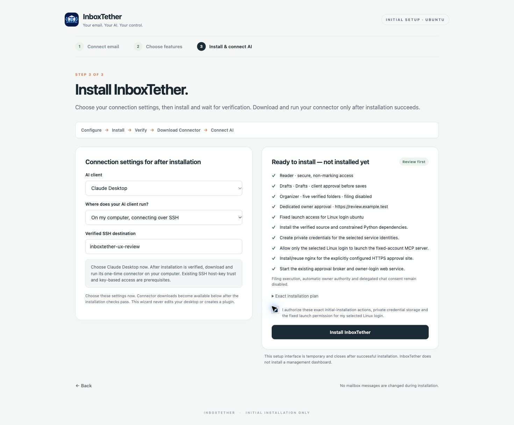
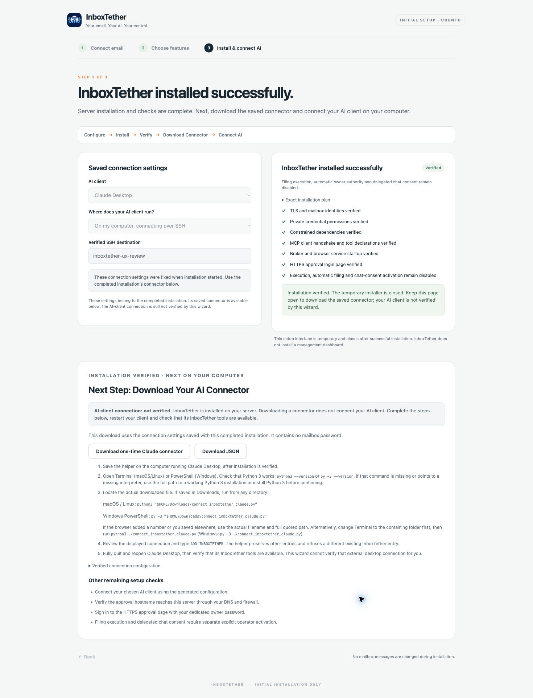
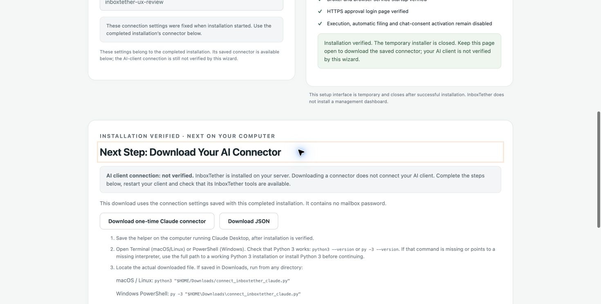
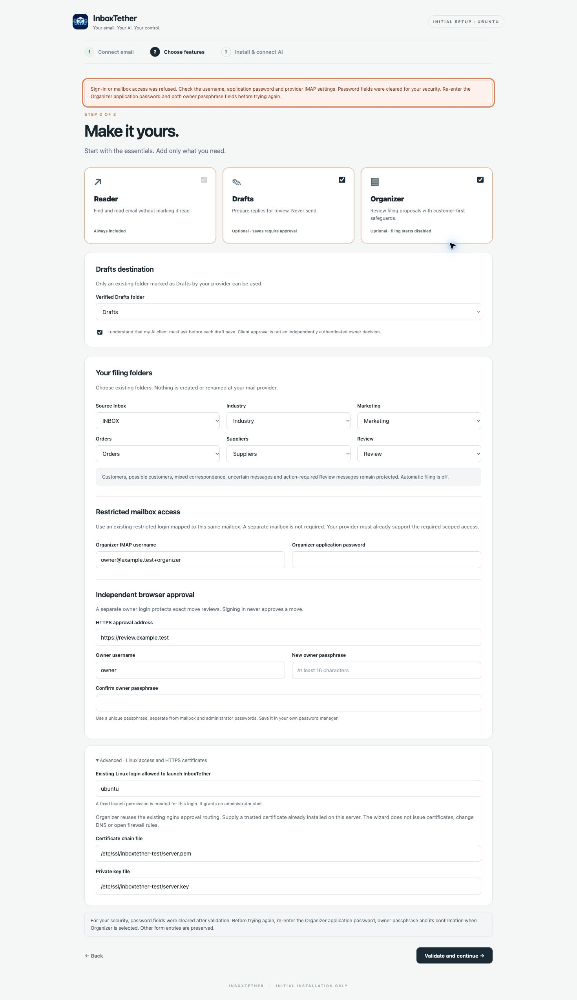

# Final wizard completion and connector acceptance

October 31, 2026. Local correction of the reviewed rc1 candidate
`6bc1a3b9f6b5145f42c1b1da6345cea8c8b6d219`; not yet published or validated by
fresh GitHub Actions on the corrected commit.

## Correction

The existing third screen now follows **Configure → Install → Verify → Download
Connector → Connect AI**. Connection settings are chosen before installation;
downloads and copying are hidden and disabled until installation verification
succeeds. The completed installation response binds the exact server-validated
connection snapshot. Settings lock when installation starts, and exports use that
completed snapshot rather than editable form fields.

After verification, the screen says **InboxTether installed successfully** and
reveals **Next Step: Download Your AI Connector**. It separately states that the
AI-client connection is not verified. The temporary installer still closes, while
the completed page retains its password-free connector. Keep that page open until
the connector has been saved; reloading a closed installer is not a recovery path.

Private-link guidance explains the complete one-time link, use in one browser,
resuming an existing authenticated session and asking the person who started setup
for a fresh link. Failed validation retains nonsecret entries but clears password
fields. The form explains which passwords must be re-entered. Password erasure,
authentication, CSRF checks and the existing installation engine are unchanged.

Connector instructions verify a working Python 3 first, use a full quoted download
path, account for browser-added filename numbers, and require checking the client
after a full restart. The one-time Claude helper implementation is unchanged.

## Fresh validation

Disposable Ubuntu 24.04 ARM64 guests, hardware-virtualized on an ARM64 Mac;
Python 3.12.3. All mailbox data, credentials and TLS fixtures were synthetic.

| Check | Result |
| --- | --- |
| Complete regression suite | 551/551 passed; no failures, errors or skips |
| Separate real-loopback HTTP security suite | 6/6 passed |
| Reader-only clean installation | Passed; five MCP tools |
| Reader plus Drafts clean installation | Passed; seven MCP tools; draft preview only, no save |
| Full Organizer clean installation through Chrome | Passed; eight MCP tools; HTTPS approval and services healthy |
| Wrong mailbox password and recovery through Chrome | Passed; visible error, nonsecret entries retained, password cleared |
| Wrong Organizer password and recovery through Chrome | Passed; explicit password re-entry guidance; all password fields cleared |
| Before/during/after installation export gating through Chrome | Passed; unavailable before verification, enabled afterward |
| Completed connection export | Exact expected configuration; MCP initialization and eight tool declarations verified over its SSH entry |
| Actual Chrome connector download | File saved; bytes exactly match the reviewed helper with the completed connection |
| Dependency consistency and advisory audit | Passed; 56 dependency records, no reported vulnerabilities at test time |
| Source integrity, prohibited sending imports and private-information checks | Passed |

Five new regression cases cover completed-snapshot binding and immutability,
running-install locking, failed-install export refusal/no retry, snapshot reset on
reconfiguration, and initially hidden/disabled exports within exactly three main
screens. The three clean installations retained their synthetic messages' flags.
The full browser installation also retained all six messages' hashes, internal
dates and source identity, saved no draft and left classification state uninitialized.
Execution, automatic filing and delegated chat consent remained disabled.

A focused repeat on disposable Ubuntu 24.04 **x86_64 software emulation** passed
all **45/45 wizard tests** and **6/6 HTTP security tests** with Python 3.12.3 and a
fresh pinned virtual environment. Its full stdout, stderr and exit codes were
retained. This was not a new full 551-test x86 run or native-hardware acceptance;
the earlier complete 546-test emulated x86 results remain historical evidence.

The actual Chrome helper download was 5,146 bytes, SHA-256:

`ab1561bb557cd32d5f5b63ca87c835b1c712f82501af0dcea8edcc56d049e0c6`

That checksum describes this synthetic test connection, not a universal helper.
The browser added a numbered filename suffix, which the new instructions address.
Automation timed out waiting for its download notification; the saved file was
independently found and verified without repeating the click or bypassing browser
security. The helper was not run or registered with a desktop client during this
correction. The JSON exporter shares the completed snapshot; its actual manual
download acceptance on the earlier candidate remains recorded separately.

Complete test stdout, stderr, exit codes and installation evidence were retained
outside the public source. No private setup links, keys, credentials, production
data or operational records are included here. The original owner test environment
and existing Claude connection were preserved.

## Actual Chrome screenshots

## Limits and release boundary

These are synthetic installation and protocol checks, not production email
acceptance. The earlier owner hands-on candidate separately passed a graphical
Claude Desktop folder-listing check. This correction does not re-register or change
that connection. Graphical ChatGPT acceptance, Windows helper execution and native
x86 hardware clean-install acceptance remain unverified. Earlier complete x86_64
results used software emulation; they are not native-hardware evidence.

The wizard does not provision provider accounts/ACLs, DNS, firewall rules or trusted
certificates, install Python on the desktop, or connect hosted clients automatically.
It remains an initial-installation wizard, not an upgrade or management interface.
Sending remains excluded; the filing engine and seven Reader/Draft contracts are
unchanged.

**GO for owner review of the corrected experimental candidate.** Fresh PR checks
on the corrected commit and explicit owner approval are required before merging,
tagging or prerelease publication. Stable 2.0 and production remain unchanged.
